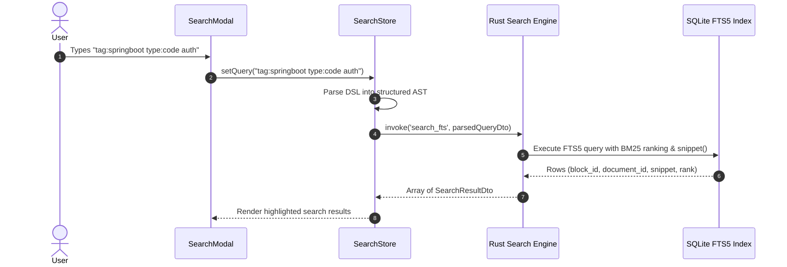

# Chronote Architecture Specification

## 1. Architectural Philosophy & Principles

Chronote is designed according to **Clean Architecture** and **Hexagonal (Ports and Adapters)** principles. 

The system enforces three strict structural rules:
1. **Business Logic Must Not Live in React Components:** React components are strictly view-layer projection artifacts. They render state, collect user events, and dispatch actions to application stores. They never perform direct I/O, regex parsing of domain rules, or database operations.
2. **Deterministic Unidirectional Data Flow:** Data flows down through props and selectors; state changes flow up through typed store actions and application services.
3. **Decoupled Native Infrastructure:** The frontend webview interacts with the native operating system exclusively through strongly-typed Tauri IPC commands. Native concerns (atomic disk writes, SQLite indexing, OS clipboard, file dialogs) reside entirely in the Rust native core.

---

## 2. High-Level Architectural Diagram

```
┌─────────────────────────────────────────────────────────────────────────────┐
│                            FRONTEND WEBVIEW (React 19)                      │
│                                                                             │
│  ┌───────────────────────────────────────────────────────────────────────┐  │
│  │                     PRESENTATION LAYER (UI)                           │  │
│  │  - MainAppLayout (Header, Left Sidebar, Editor Canvas, Resource Pane) │  │
│  │  - TabBar & TabView Controls                                          │  │
│  │  - DsmTimelineView (Virtualized Entry Stream, Collapse Controls)      │  │
│  │  - GeneralNoteEditor (Title, Tags Bar, Content Canvas)                │  │
│  │  - Tiptap 3.x Rich-Text Engine (Custom Nodes, InputRules, Extensions) │  │
│  └───────────────────────────────────┬───────────────────────────────────┘  │
│                                      │ Dispatches Actions / Reads State     │
│  ┌───────────────────────────────────▼───────────────────────────────────┐  │
│  │                APPLICATION LAYER (State & Use Cases)                  │  │
│  │  - WorkspaceStore (Active workspace, path, initialization state)      │  │
│  │  - DsmJournalStore (DSM entries, active date, collapse states)        │  │
│  │  - GeneralNotesStore (Note catalog, active note, dirty states)        │  │
│  │  - TabsStore (Open tabs, active tab ID, tab history stack)            │  │
│  │  - SearchStore (Query parser, filter predicates, search results)      │  │
│  │  - ResourceBrowserStore (Indexed code blocks, images, links, files)   │  │
│  │  - AutosaveOrchestrator (Debounced save queues, dirty tracking)       │  │
│  └───────────────────────────────────┬───────────────────────────────────┘  │
│                                      │ Operates On                          │
│  ┌───────────────────────────────────▼───────────────────────────────────┐  │
│  │                      DOMAIN LAYER (Pure TypeScript)                   │  │
│  │  - Entities: DsmDocument, DsmEntry, GeneralNote, Block, Tag, Asset    │  │
│  │  - Value Objects: NoteId, EntryId, BlockId, AssetId, DateString       │  │
│  │  - Validators & Contracts (Zod Schemas)                               │  │
│  │  - Tag Normalizer & Search Query AST                                  │  │
│  └───────────────────────────────────┬───────────────────────────────────┘  │
│                                      │ Invokes Commands                     │
│  ┌───────────────────────────────────▼───────────────────────────────────┐  │
│  │               INFRASTRUCTURE / IPC ADAPTER (Tauri Client)             │  │
│  │  - TauriWorkspaceBridge (create, open, validate workspace)            │  │
│  │  - TauriPersistenceBridge (loadNote, saveNoteAtomic, listNotes)       │  │
│  │  - TauriSearchBridge (executeFtsQuery, reindexWorkspace)              │  │
│  │  - TauriAssetBridge (saveAssetBinary, deleteAsset, resolveAssetUrl)   │  │
│  │  - TauriExportBridge (exportMarkdown, exportDocx, exportPdf, zip)     │  │
│  └───────────────────────────────────┬───────────────────────────────────┘  │
└──────────────────────────────────────┼──────────────────────────────────────┘
                                       │ Strongly-Typed Tauri IPC Commands
                                       │ (JSON serialization over IPC bridge)
┌──────────────────────────────────────▼──────────────────────────────────────┐
│                         NATIVE CORE (Rust 2021 Stable)                      │
│                                                                             │
│  ┌───────────────────────────────────────────────────────────────────────┐  │
│  │                       TAURI COMMAND CONTROLLERS                       │  │
│  │  - workspace_commands::*                                              │  │
│  │  - note_commands::*                                                   │  │
│  │  - search_commands::*                                                 │  │
│  │  - asset_commands::*                                                  │  │
│  │  - export_commands::*                                                 │  │
│  └───────────────────────────────────┬───────────────────────────────────┘  │
│                                      │ Executes Business & Native I/O       │
│  ┌───────────────────────────────────▼───────────────────────────────────┐  │
│  │                       RUST NATIVE DOMAIN & ENGINES                    │  │
│  │                                                                       │  │
│  │  ┌─────────────────────────┐        ┌──────────────────────────────┐  │  │
│  │  │   Storage & I/O Engine  │        │   Search & Indexing Engine   │  │  │
│  │  │  - Atomic File Writer   │        │  - SQLite 3 Connection Pool  │  │  │
│  │  │    (tmp -> fsync -> mv) │        │  - FTS5 Virtual Tables       │  │  │
│  │  │  - Workspace Scanner    │        │  - Trigram Code Indexer      │  │  │
│  │  │  - Asset File Manager   │        │  - Relational Metadata Cache │  │  │
│  │  │  - Directory Watcher    │        │  - Rebuild Index from Disk   │  │  │
│  │  └───────────┬─────────────┘        └──────────────┬───────────────┘  │  │
│  │              │                                     │                  │  │
│  │  ┌───────────▼─────────────┐        ┌──────────────▼───────────────┐  │  │
│  │  │   Export & Archive      │        │   Security & Capability Gate │  │  │
│  │  │  - Markdown Serializer  │        │  - Filesystem Path Scoping   │  │  │
│  │  │  - OpenXML DOCX Engine  │        │  - Shell URL Open Allowlist  │  │  │
│  │  │  - Native Zip Packager  │        │  - Path Traversal Guard      │  │  │
│  │  └─────────────────────────┘        └──────────────────────────────┘  │  │
│  └───────────────────────────────────────────────────────────────────────┘  │
└─────────────────────────────────────────────────────────────────────────────┘
```

---

## 3. Detailed Component Breakdown

### 3.1 Presentation Layer (`src/presentation/`)
- **Framework:** React 19 with functional components and TypeScript strict mode.
- **Styling:** Modular Vanilla CSS with CSS custom properties (tokens for colors, typography, spacing, elevations). Zero TailwindCSS.
- **Editor Subsystem:**
  - Built on Tiptap 3.x / ProseMirror.
  - Custom Node Views: `CodeBlockNodeView` (with language selector, copy button, line numbers), `DsmEntryNodeView` (with collapse toggle, date header, entry tags bar), `InternalLinkMark` (with click navigation and hover preview).
  - Custom Input Rules: Markdown triggers (`#`, `##`, `- `, ````, `> `) that mutate the schema and consume trigger characters.
- **Component Boundaries:**
  - `components/layout/`: AppHeader, NavigationSidebar, TabBar, MainContentArea, ResourcePane.
  - `components/dsm/`: DsmTimeline, DsmEntryItem, DsmEntryHeader, DsmDatePicker.
  - `components/notes/`: NoteEditorHeader, NoteTitleInput, NoteTagBar, NoteEditorCanvas.
  - `components/search/`: SearchModal, SearchResultItem, SearchFilterChips.
  - `components/resources/`: ResourceBrowser, CodeBlockCard, ImageThumbnail, LinkItem.

### 3.2 Application Layer (`src/application/`)
- **State Management:** Zustand 5.x.
  - Stores organized by bounded context:
    - `useWorkspaceStore`: Active workspace directory, recent notes, and indexing status.
    - `useDsmStore`: Continuous stand-up journal timeline, date jump, collapse states, and multi-tag filtering.
    - `useNotesStore`: General notes catalog, active note, dirty states, and multi-tag filtering.
    - `useTabsStore`: Multi-document tab bar with DSM pinning and session restore.
    - `useSearchStore`: Query parser, filter predicates, and FTS5 search results.
    - `useResourceStore`: Indexed code blocks, images, links, attachments, and backlinks.
    - `useTocStore`: Live ProseMirror heading outline extraction, active cursor context tracking (`general` vs `dsm`), heading navigator registration, and exact cursor navigation.
    - `useUiStore`: Zoom scaling state, viewport dimension compensation, HUD overlay, and interactive sidebar width resizing with persistence.
- **Autosave Engine:**
  - Intercepts document mutations from the editor.
  - Debounces writes (default: 800 ms idle or immediately on tab switch / window blur).
  - Maintains dirty flags to prevent redundant disk I/O.
- **Service Interfaces:**
  - Abstract interfaces for persistence, search, export, and clipboard to ensure complete testability without a live Tauri runtime.

### 3.3 Domain Layer (`src/domain/`)
- Pure TypeScript, zero external framework dependencies (except Zod for schema validation).
- Defines entities, types, and invariants:
  - `DsmDocument`, `DsmEntry`, `GeneralNote`, `Block`, `Tag`, `AssetReference`, `ResourceItem`.
- Encapsulates domain operations:
  - `normalizeTag(rawTag: string): string`
  - `parseSearchQuery(rawQuery: string): SearchQueryAst`
  - `deriveDsmEntryPreview(content: ProseMirrorNode): string`
  - `validateNoteSchema(json: unknown): Result<Note, ValidationError>`

### 3.4 Infrastructure & IPC Layer (`src/infrastructure/`)
- Implements application service interfaces by delegating to Tauri's `invoke()` API:
  - `saveNote(payload: SaveNoteDto): Promise<void>`
  - `loadNote(id: string): Promise<NoteDto>`
  - `searchFts(query: SearchQueryDto): Promise<SearchResultDto[]>`
  - `importAsset(filePath: string): Promise<AssetMetadataDto>`
- Includes mock/in-memory implementations for automated browser testing (Vitest / Playwright).

### 3.5 Native Rust Core (`src-tauri/src/`)
- **Crates & Modules:**
  - `storage`: Manages atomic filesystem reads and writes. Implements `.tmp` -> `fsync` -> `rename` pattern.
  - `database`: Manages SQLite connection pool via `rusqlite` (bundled with FTS5). Runs migrations and initializes schema.
  - `search`: Ingests note blocks into FTS5 virtual tables; translates frontend search AST into optimized FTS5 queries with BM25 ranking and snippet generation.
  - `assets`: Copies or writes binary assets into `assets/images/` and `assets/files/` with secure UUID/ULID filenames; ensures zero path traversal outside the workspace boundary.
  - `export`: Serializes ProseMirror JSON to CommonMark GFM, Microsoft Word OpenXML (`.docx`), and generates lossless `.zip` backup archives.
  - `watcher`: Uses `notify` crate to detect external file modifications (e.g. from cloud sync tools) and trigger cache reindexing.

---

## 4. Key End-to-End Data Flows

### 4.1 Note Save Flow (Autosave & Atomic Persistence)
```mermaid
sequenceDiagram
    autonumber
    actor User
    participant Editor as Tiptap Editor
    participant Store as NotesStore / Autosave
    participant IPC as Tauri IPC Bridge
    participant Rust as Rust Storage Engine
    participant Disk as Local Filesystem
    participant DB as SQLite FTS5 Index

    User->>Editor: Types content (e.g. Markdown or text)
    Editor->>Store: onUpdate(jsonDoc)
    Store->>Store: Mark note as dirty; start 800ms debounce timer
    Note over Store: 800ms elapses without input
    Store->>IPC: invoke('save_note', { id, content, tags, updatedAt })
    IPC->>Rust: Tauri command dispatch
    Rust->>Disk: Write payload to 'notes/{id}.json.tmp.{pid}'
    Rust->>Disk: Flush OS buffers via File::sync_all()
    Rust->>Disk: Atomic rename '.tmp' to 'notes/{id}.json'
    Rust->>DB: Asynchronously update metadata & FTS5 blocks
    Rust-->>IPC: Ok(savedTimestamp)
    IPC-->>Store: Clear dirty flag, update lastSavedAt
```

### 4.2 Fast Search Flow (< 50 ms)


---

## 5. Cross-Platform Strategy

- **Phase 1 (Windows MVP):**
  - Targets Windows 10 (1809+) and Windows 11 64-bit.
  - Runtime: Microsoft Edge WebView2 (Evergreen, pre-installed on Windows 10/11).
  - Path separators: Normalized to forward slashes internally; Windows UNC / backslash paths normalized at the Rust boundary.
- **Phase 4 (Linux Readiness):**
  - Frontend and Rust domain logic contain zero Windows-specific APIs.
  - Rust file operations use standard `std::path::Path` and `std::path::PathBuf`.
  - WebView on Linux utilizes standard WebKitGTK via Tauri's platform abstraction.
  - SQLite, FTS5, and file I/O behave identically across OS boundaries.
